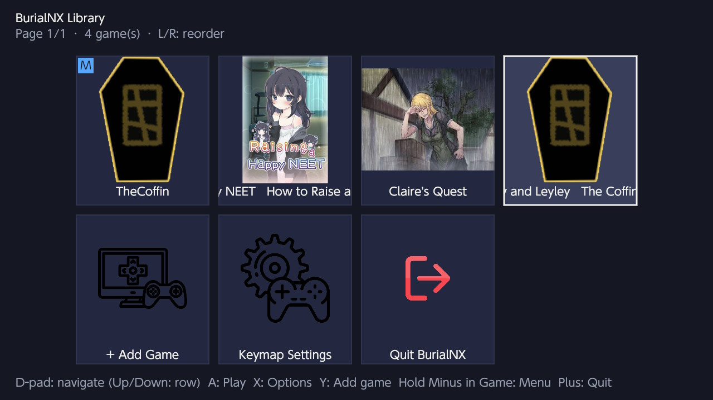
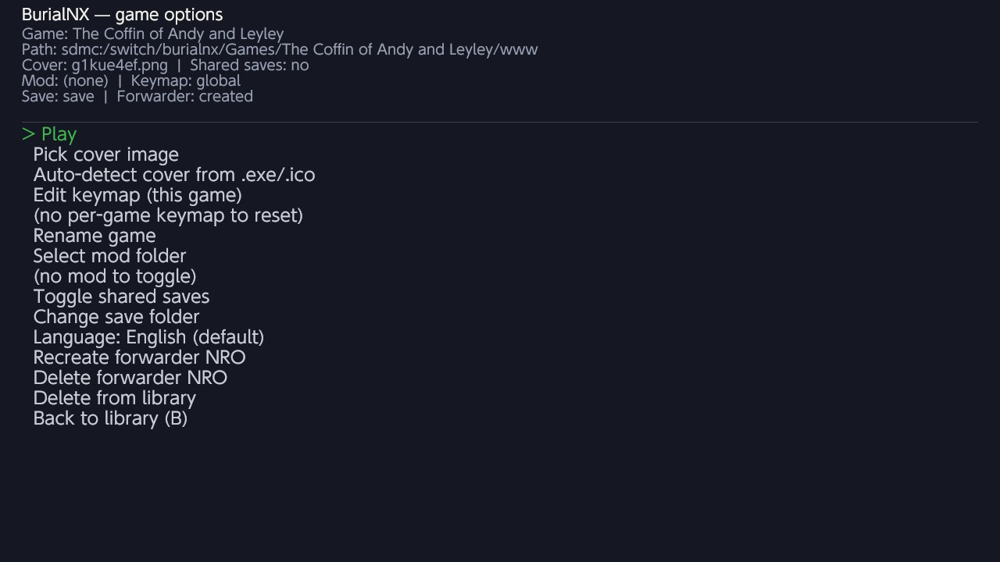
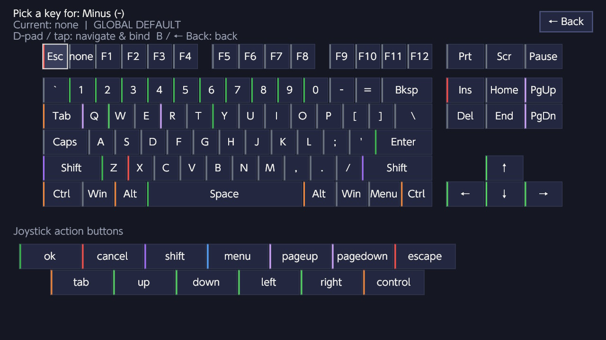
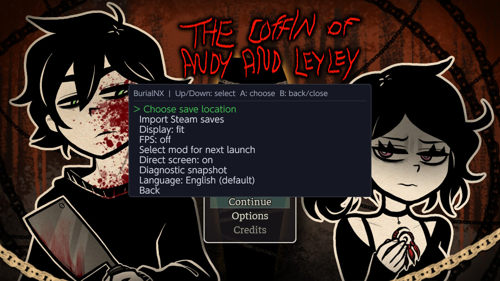

# ⚰️ BurialNX

**Independent Switch homebrew loader for RPG Maker MV Games**

BurialNX is a Nintendo Switch homebrew application built on [nx.js](https://github.com/tofuness/nx.js) that runs RPG Maker MV games on the Switch. It is not a general-purpose RPG Maker player — it is specifically tested on *The Coffin of Andy and Leyley* (TCOAAL).

---

## 📸 Screenshots

### Library


Browse your game library with cover thumbnails. Reorder games with **L/R** shoulder buttons.

### Game Options


Per-game settings: cover, keymap, mod, saves, language, and forwarder management.

### Keymap Editor


Full visual keyboard picker — remap any joycon button to any keyboard key or gamepad action. Per-game keymaps with presets.

### In-Game Pause Menu


Hold **Minus** in-game to access the pause menu: save, load, edit keymap, switch language, or return to library.

### In-Game Options


Options are fully translated — Always Dash, BGM/SFX Volume, On/Off — using the language pack's translation tables.

---

## ✨ Features

### 🎮 Library & Game Management
- **Multi-game library** with JSON persistence on the SD card
- **Cover thumbnails** — auto-extracted from .exe/.ico, or pick your own PNG/JPG/GIF/WebP
- **Game reordering** — move games up/down with L/R shoulder buttons
- **Rename games** — type a custom name, or pick one from a folder/file
- **Mod support** — select a mod folder, enable/disable per-game
- **Save management** — Switch user data, SD card, or game folder; import Steam saves

### 🌍 Localization (Russian)
- **`.cld` language pack** loading — text, embedded font, translated images
- **Full translation** — menu items, dialogue, options (Always Dash → Всегда бежать, BGM Volume → Громкость музыки, On/Off → Вкл./Выкл.)
- **YEP_MessageCore override** — dialogue windows use the localized font with Cyrillic glyphs
- **Language switching** — cycle languages with L/R in pause menu or library settings
- **Preference persisted** in library.json (works in forwarder NROs with saveData=0)

### 🎨 Visual
- **Selection border** renders on top of cover images
- **Cover format support** — PNG, JPG, JPEG, GIF, WebP, ICO, EXE (auto-detect from magic bytes)
- **Marquee scrolling** for long game names
- **Touch screen** support for all UI navigation

### 🕹️ Key Remapping
- **Visual keyboard picker** — 60+ keys, navigate with D-pad or touch
- **Per-game keymaps** — override the global default per game
- **Stick bindings** — L-stick and R-stick directions map to keys
- **Presets** — L/ZL/R/ZR apply common configurations instantly

### 📦 Forwarder NROs
- **Self-contained forwarder** — baked-in game ID, no chain-loading
- **Auto-naming** — folder/file based on sanitized game name (spaces → underscores)
- **Rename on game rename** — forwarder folder + .nro are renamed automatically
- **Clean deletion** — removes .nro, folder, and leftover files

### 🔧 Technical
- **Node.js / NW.js compatibility** — polyfills `require`, `process`, `Buffer`, `nw` globals
- **Audio panning** — StereoPanner fallback for nx.js's missing createPanner
- **Exit crash fix** — removes beforeunload listener before Switch.exit (prevents infinite recursion)
- **Memory management** — explicit GC after forwarder build (frees 54 MB)
- **Debug build** — extra logging, diagnostic snapshots, numbered log files

---

## 🚀 Installation

### Requirements
- Nintendo Switch with Atmosphère or hbmenu
- SD card

### Steps
1. Download `BurialNX-*.nro` from [Releases](../../releases)
2. Copy to `sdmc:/switch/burialnx/burialnx.nro`
3. Launch from hbmenu
4. Select "Add Game" and browse to your game's `www` folder
5. Play!

### Game Setup
- Game must have `www/index.html` and `www/js/rpg_core.js`
- Place `.cld` language packs in `www/languages/`
- Cover images: place in the game folder or use auto-detect from .exe

---

## 🎯 Controls

| Button | Action |
|--------|--------|
| **D-Pad** | Navigate library/options |
| **A** | Select / Play / Confirm |
| **B** | Back / Cancel |
| **X** | Game options (in library) |
| **Y** | Add game |
| **L / R** | Reorder games (library) / Cycle language (pause menu & options) |
| **Minus** | Pause menu (hold in-game) |
| **Plus** | Quit (hold) |

---

## 🏗️ Building from Source

### Prerequisites
- Node.js 18+
- npm

### Build
```bash
git clone https://github.com/greg6821-debug/BurialNX.git
cd BurialNX
npm install
npm test          # 148 tests
npm run build     # → burialnx.nro
npm run build -- --debug  # → burialnx-debug.nro
```

### GitHub Actions
This repo includes a manual build workflow. Go to **Actions → "Build NRO" → Run workflow**, enter a version tag, and GitHub builds the .nro and creates a release automatically.

---

## 📜 License

AGPL-3.0-or-later. See [LICENSE](LICENSE).

BurialNX is an independent homebrew project. It is not affiliated with or endorsed by the creators of The Coffin of Andy and Leyley. All game content belongs to their respective owners.
