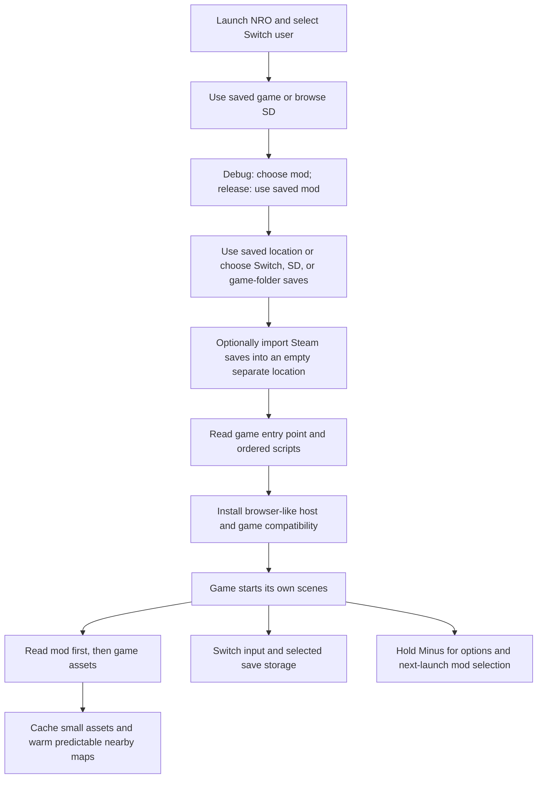

# How BurialNX works

The NRO contains nx.js and the loader, not a game. The loader reads the user's
game and optional mod from the SD card. It supplies the limited browser-like
APIs that RPG Maker MV expects and runs the game's own JavaScript. It is not a
full browser or a general-purpose RPG Maker player.

## Code map

- `src/main.ts` connects startup, the options menu, logging, and error handling.
  At startup it also selects the Switch user once (by touching `localStorage`,
  whose lazy getter in nx.js mounts save data and shows the system profile
  selector when no user is preselected) and logs the granted V8 heap size in
  debug builds. `teardownGame()` fully retires a running game — audio stopped,
  the game's rAF loop permanently retired, image
  caches cleared, the game's fonts removed and pending timers cancelled, and
  a full GC pass — and is used by the quit path, so a stopped game cannot
  keep running, play sound, or hold native memory.
  Retiring the frame loop is a two-layer defense: (1) the pending rAF
  callback is the game's ORIGINAL bound `SceneManager.update`, which
  property stubs cannot reach, so `beginGameSession()` also wraps
  `requestAnimationFrame` to track every frame id the game schedules and
  `endGameSession()` cancels them all before deleting globals (nx.js's rAF
  is a plain cancellable callback queue); (2) a frame already dequeued for
  the current vsync batch still runs the bound update after the teardown,
  so the teardown stubs EVERY manager method update's try/catch can reach
  (`update`, `updateMain`, `requestUpdate`, `renderScene`, `tickStart`,
  `tickEnd`, `updateInputData`, `updateScene`, `changeScene`,
  `catchException`, `stop`, `terminate`) — its own try/catch then swallows
  the first `… is not defined` error and the stubbed `catchException` ends
  the chain for good. Without this, the dequeued update's `tickStart()` →
  `Graphics.tickStart()` and `catchException` → `Graphics.printError()`
  threw escaping `ReferenceError`s into nx.js, which terminates the whole
  process for any uncaught rAF exception (the hardware crash: "Graphics is
  not defined" frozen on a "Loading…" splash, killing the process between
  teardown and `Switch.exit()` instead of letting it exit cleanly).
  Because the game runs in the loader's realm, `beginGameSession()` snapshots
`globalThis` at launch and `endGameSession()` restores it at teardown:
game-created globals are deleted and host-replaced values (document, fetch,
Image, …) return to the native originals, which is what actually frees the
retained native audio/font/pixel memory. The session
`error`/`unhandledrejection` listeners also call `preventDefault()` on the
dispatched events: nx.js kills the process with a frozen "Press + to exit"
screen for ANY uncaught exception or unhandled rejection unless the event
is canceled, and the loader shows its own recoverable error screen instead.
There is no in-process session reboot: returning to the library means
quitting the app (`quitApp()` → `teardownGame()` → `Switch.exit()`) and
relaunching it from hbmenu, which is a guaranteed clean cold boot — Horizon
OS reserves the process memory and reclaims it on exit, the only reliably
clean reset on this OS. An in-process reboot (re-running the app bundle from
`romfs:/main.js` in a fresh function scope) was implemented and hardened
across several iterations but proved unstable on hardware: it froze on the
"Loading…" splash with `FAILURE: ReferenceError: Graphics is not defined`
(a late game frame referencing the deleted `Graphics` global escaped into
nx.js, which terminates the whole process for any uncaught rAF exception).
The full teardown (audio, frame loop, caches, realm restore, GC) is still
performed before `Switch.exit()` on the quit path, so no stopped game can
keep running or hold memory while the process dies. The error screen's
B button uses the same quit path. `renderRenameKb()` draws the rename input
field: it re-reads `vk.value`/`vk.cursorIndex` every frame (so the preview
tracks typing even without `change` events), anchors the field above the
keyboard's real on-screen rectangle (`vk.boundingRect` from `show()`), and
falls back to a fixed top band without geometry.
- `src/runtime-plan.ts` selects the game's normal load handler or, if absent,
  starts its boot scene when no scene is already active or queued.
- `src/folders.ts` and `src/settings.ts` handle SD selection and remembered paths.
- `src/game-assets.ts` reads an optional mod overlay, resolves encoded game
  assets, shares concurrent image/data reads, and keeps a bounded in-memory
  cache. Nothing is written to the game.
- `src/map-prefetch.ts` scans the current map's direct transfer events and
  warms up to three destination map files through that same cache. It waits
  for a settled, sufficiently smooth map scene, reads one file at a time,
  and discards obsolete queued work on map changes. Variable-based transfers
  cannot be predicted. This does not load whole episodes or decoded images;
  the shared cache remains limited to 16 MiB and 2 MiB per item.
- `src/browser-host.ts` implements the small document, canvas, image, local
  request, and script interfaces needed by the game. nx.js supplies the
  actual canvas, audio, image decoding, and timers. The resource fetch bridge
  rejects external and native filesystem URLs; this is not a script sandbox.
  The Image wrapper and resource fetch are installed around the native
  originals, and the game-session teardown restores those natives, so every
  launch installs fresh wrappers and returning to the library plus starting
  another game never stacks wrappers on top of each other.
- `src/game-compat.ts` contains the game and engine adapters described below.
  Screen touch events are forwarded to `document` through a single process-wide
  listener set that resolves the current `document` at event time, so a second
  launch keeps touch input working with its fresh document.
- `src/indexed-png.ts` handles an indexed PNG color issue only if a runtime
  probe shows that the correction is needed.
- `src/repeated-pattern.ts` batches tiny repeating textures into bounded
  tiles, reducing the number of native draw calls while preserving their pixels.
- `src/menu.ts` contains menu input state; debug-only choices are excluded from
  the release build.
- `src/saves.ts` supports separate SD or explicitly selected game-folder
  storage, retains recovery copies on interrupted writes, and imports Steam
  files only into an empty separate destination.
- `src/forwarder.ts` builds per-game forwarder NROs at runtime. A forwarder
  is a small self-contained nx.js NRO whose `main.js` reads a sidecar JSON
  next to itself and chain-loads `burialnx.nro` with `--game <id>` (via
  `Switch.Application(...).launch`, which nx.js implements as a call to
  libnx `envSetNextLoad` — the same primitive sphaira's `nro_launch` uses).
  The module is pure JS (no Switch access at module top level): it decodes
  the NRO0/ASET layout, patches the NACP title/author/id, re-encodes a
  256×256 JPEG icon from the game cover via `OffscreenCanvas.convertToBlob`,
  and rebuilds the asset section. The template NRO is embedded at build
  time into burialnx.nro's own romfs (`romfs:/forwarder-template.nro`,
  see `forwarder-template/`), so the runtime builder only needs to copy +
  patch it per game.
- `main.ts` now also parses `Switch.argv` for `--game <id>` at startup and,
  if found and the id is in the library, auto-launches the game directly
  (the entry point for forwarder chain-loads). The launch flow reports
  per-stage progress to a centered progress bar (`renderLoading`) instead
  of the old top-left text panel. The new `forwarder-building` phase
  drives `buildForwarder()` with the same progress bar, and ignores the
  Plus button so a multi-MiB NRO write is never interrupted mid-write.

## Why compatibility code is needed

The game was built for a desktop browser runtime. nx.js provides a JavaScript
runtime and native graphics and audio, but not every browser or Node API.
Compatibility code is intentionally grouped and commented so contributors can
understand and test each difference:

- One desktop audio streaming plugin is skipped in favor of RPG Maker's audio
  path. A Node-specific payload is removed from a region plugin while keeping
  its collision rules; an unrecognized payload fails instead of guessing.
- The title's Credits command and credits-scene requests are disabled as a
  safety measure until that scene can be reliably supported on Switch.
- The game's own language table and fonts are read from the selected game.
  In-memory asset decoding and hashed-path lookup support its file layout.
- Switch buttons map to RPG Maker input. Audio panning and asynchronous audio
  decoding are adapted to the nx.js APIs.
- Local save keys preserve the earlier loader's shared or path-specific
  naming. The game still supplies the save and load interfaces.
- Text and intro positioning include narrowly scoped adjustments for observed
  game behavior. Native canvas reuse and bounded caching limit allocations.

These adapters are experimental, including the game-specific adjustments.
They do not establish compatibility with other games or every plugin. The
normal build omits routine loader logs; the debug build includes progress,
errors, scene status, and extra menu choices, but does not log every successful
image load. Neither changes game assets or scripts; saves and recovery files
are written inside the game folder only when that location is explicitly selected.

## Verification limits

`npm test` runs isolated unit tests. With `BURIALNX_GAME_ROOT` pointing to a
user-supplied game `www` directory, `npm run smoke` evaluates the actual
startup scripts, simulates frames through the new-game map, and checks game
save/load using an in-memory SD filesystem. The smoke test uses fake images,
graphics, audio, and storage: it cannot verify rendering, real input,
performance, real SD writes, or stability on hardware.
Gameplay has been reported working on Switch, including room transitions;
coverage of other scenes, mods, configurations and long sessions is incomplete.
Review the exact packaged runtime's licenses and applicable legal requirements
before a public binary release.
See [SECURITY.md](SECURITY.md) for the threat model and reporting guidance.
