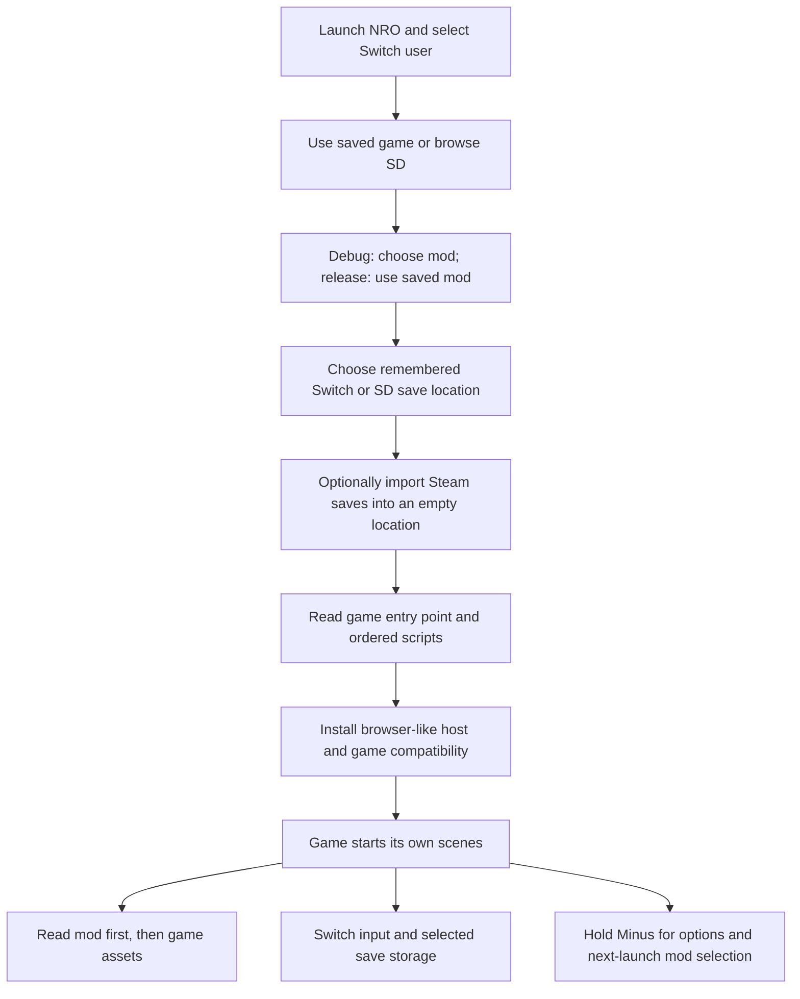

# How BurialNX works

The NRO contains nx.js and the loader, not a game. The loader reads the user's
game and optional mod from the SD card. It supplies the limited browser-like
APIs that RPG Maker MV expects and runs the game's own JavaScript. It is not a
full browser or a general-purpose RPG Maker player.

## Code map

- `src/main.ts` connects startup, the options menu, logging, and error handling.
- `src/folders.ts` and `src/settings.ts` handle SD selection and remembered paths.
- `src/game-assets.ts` reads an optional mod overlay, resolves encoded game
  assets, and keeps a bounded in-memory cache. Nothing is written to the game.
- `src/browser-host.ts` implements the small document, canvas, image, local
  request, and script interfaces needed by the game. nx.js supplies the
  actual canvas, audio, image decoding, and timers. The resource fetch bridge
  rejects external and native filesystem URLs; this is not a script sandbox.
- `src/game-compat.ts` contains the game and engine adapters described below.
- `src/indexed-png.ts` handles an indexed PNG color issue only if a runtime
  probe shows that the correction is needed.
- `src/repeated-pattern.ts` batches tiny repeating textures into bounded
  tiles, reducing the number of native draw calls while preserving their pixels.
- `src/menu.ts` contains menu input state; debug-only choices are excluded from
  the release build.
- `src/saves.ts` selects SD storage, retains recovery copies on interrupted
  writes, and imports Steam files only into an empty destination.

## Why compatibility code is needed

The game was built for a desktop browser runtime. nx.js provides a JavaScript
runtime and native graphics and audio, but not every browser or Node API.
Compatibility code is intentionally grouped and commented so contributors can
understand and test each difference:

- One desktop audio streaming plugin is skipped in favor of RPG Maker's audio
  path. A Node-specific payload is removed from a region plugin while keeping
  its collision rules; an unrecognized payload fails instead of guessing.
- The title's Credits command and credits-scene requests are disabled as a
  safety measure until that scene can be reliably supported on Switch.
- The game's own language table and fonts are read from the selected game.
  In-memory asset decoding and hashed-path lookup support its file layout.
- Switch buttons map to RPG Maker input. Audio panning and asynchronous audio
  decoding are adapted to the nx.js APIs.
- Local save keys preserve the earlier loader's shared or path-specific
  naming. The game still supplies the save and load interfaces.
- Text and intro positioning include narrowly scoped adjustments for observed
  game behavior. Native canvas reuse and bounded caching limit allocations.

These adapters are experimental, including the game-specific adjustments.
They do not establish compatibility with other games or every plugin. The
normal build omits routine loader logs; the debug build includes progress,
logs, and extra menu choices. Neither changes the user's game files.

## Verification limits

`npm test` runs isolated unit tests. With `BURIALNX_GAME_ROOT` pointing to a
user-supplied game `www` directory, `npm run smoke` evaluates the actual
startup scripts, simulates frames through the new-game map, and checks game
save/load using an in-memory SD filesystem. The smoke test uses fake images,
graphics, audio, and storage: it cannot verify rendering, real input,
performance, real SD writes, or stability on hardware.
Real Switch testing and legal review remain necessary before a public release.
See [SECURITY.md](SECURITY.md) for the threat model and reporting guidance.
